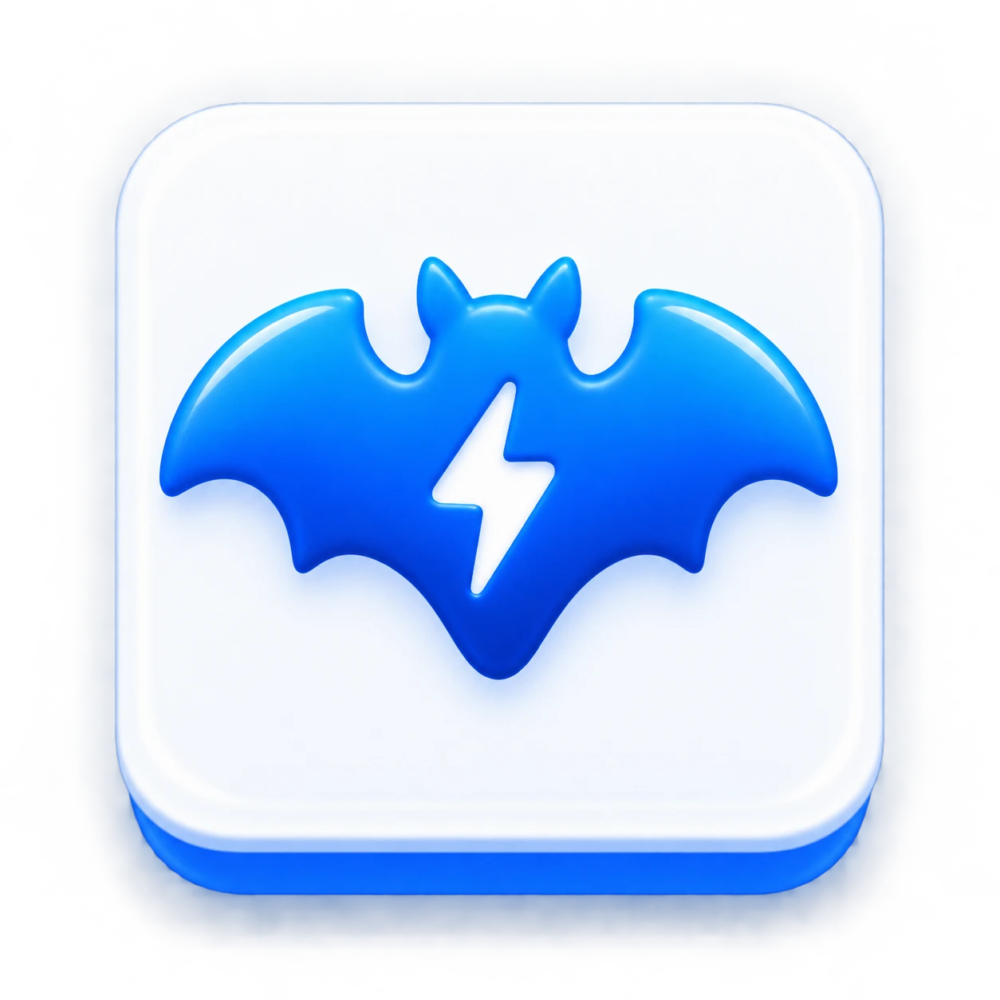
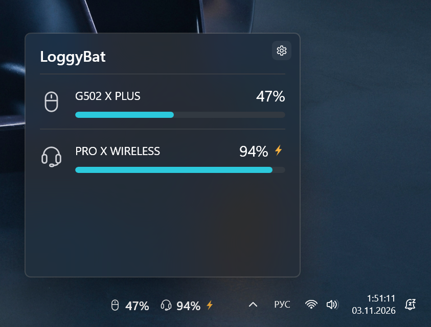

# LoggyBat

**A widget for WidBar that shows the battery level of Logitech devices via G HUB.**

[Русская версия](README.ru.md)

LoggyBat is not a separate panel and not a replacement for WidBar. It is a widget: the
[WidBar](https://apps.microsoft.com/detail/9PKLDNM83TP9) app puts it on the Windows 11 taskbar, and it
gets the battery levels from a running Logitech G HUB. You need **WidBar** and a **running Logitech G HUB**.

## Features

- **Battery on the taskbar.** An icon and the charge of up to three Logitech devices that G HUB reports a
  battery level for; an orange bolt while a device is charging.
- **Widget window «Шкалы».** Every device with its icon, name, charge and a turquoise bar.
- **Settings** (WidBar's gear): how many devices the taskbar shows, which ones and in what order.
- **Update check.** A red dot and a link to the new release when one is out; **Check now** in the
  settings with its result right below it. The automatic check can be switched off. Nothing is
  downloaded or installed automatically.
- **Light and dark Windows theme.**

## Requirements

- Windows 11, x64
- [WidBar](https://apps.microsoft.com/detail/9PKLDNM83TP9) from Microsoft Store — **install it first**
- [Logitech G HUB](https://www.logitechg.com/software/ghub) — running and seeing your devices

## First installation

1. Install **WidBar** from Microsoft Store: https://apps.microsoft.com/detail/9PKLDNM83TP9
   (it also installs the Microsoft Visual C++ framework packages LoggyBat needs).
2. Install **Logitech G HUB**: https://www.logitechg.com/software/ghub — and make sure it sees your devices.
3. Download the **first-install kit** (`LoggyBat-first-install-x64-<version>.zip`) from the
   [Releases](https://github.com/mrmaxxxx/LoggyBat/releases) page and unpack it into a separate folder.
   The terms of use (`TERMS.md`), the license (`LICENSE`) and the third-party licenses and notices
   (`Notices\`) are in the kit — you can read them before installing.
4. Right-click `Install-LoggyBat.ps1` → **Run with PowerShell**. The script:
   1. shows the terms of use and asks you to type **YES** (or **ДА**). Any other answer stops the
      installation; nothing on the computer is changed;
   2. checks that the Microsoft Visual C++ framework packages (VCLibs) that come with WidBar are installed
      for your account, in the version LoggyBat needs. If not, it stops: install or update WidBar from
      Microsoft Store and run the script again;
   3. starts Microsoft's installation script from the kit (`Install.ps1`), which installs the certificate,
      the Windows App Runtime from the kit and LoggyBat.
5. Add the widget: **WidBar → Layout → Refresh → LoggyBat**.

> [!WARNING]
> **About the certificate.** LoggyBat is signed with the developer's **self-signed certificate `CN=Max`**,
> not through Microsoft Store. During installation Microsoft's script offers to add this certificate to the
> trusted certificates of the computer (Trusted People); this needs **administrator rights**. Trust the
> certificate only if you trust the source you downloaded LoggyBat from.

The first installation with this kit has **not yet been tested on a clean computer**.

## Update

If LoggyBat is already installed, use the **update kit** (`LoggyBat-update-x64-<version>.zip`):

1. Unpack it into a separate folder.
2. **Close WidBar completely** (tray icon → Exit): Windows cannot replace the files of a running widget.
3. Right-click `Update-LoggyBat.ps1` → **Run with PowerShell**. If you have not accepted this version of
   the terms before, it shows them and asks for **YES** / **ДА**; declining stops with no changes.
   The script installs the new version over the old one (no uninstall) and starts WidBar again.
   If this version is already installed but you have not accepted the terms in the kit yet, the script
   only shows them and records your consent; nothing is installed.

A standalone `.msix` is not offered as a separate installation method.

## What it shows

- **Taskbar:** an icon and the charge for each device (`92%`), an orange bolt while it is charging, `—`
  when there is no charge. The icons have the same colour as the charge text.
- **Flyout:** every device with its icon, name, charge and a turquoise bar; the orange bolt while
  charging; an empty bar and `—` when there is no charge. Unknown device types get an adapter icon.
- A red dot on the right of the taskbar part when a newer release is found (see *Update check*).

## Settings

Open the flyout and click WidBar's gear (or *Configure* in WidBar). WidBar saves the settings with
**Save**; **Cancel** brings back the previous look.

- **How many devices** the taskbar shows: 1, 2 (default) or 3.
- **Which devices and in what order.** Nothing ticked (default) = automatic: mouse, headset, keyboard,
  microphone, others. A ticked device keeps its place while it is off: the taskbar shows `—` and no other
  device moves in. Devices are remembered by model, because G HUB gives no permanent id for a single
  unit: two identical devices are ticked and moved together, and each is still shown separately with its
  own charge.
- **Updates:** the installed version, **Проверить сейчас** (Check now) with its result right below it (a found
  update with a link to its release page, "no updates" or an error), and the automatic check.

## Update check

LoggyBat can tell you that a new version is out: a red dot appears on the right of the widget and the
flyout shows the version with a link to its release page. **Nothing is downloaded or installed
automatically** — you install the update kit yourself.

To find out, LoggyBat asks GitHub for the latest published release
(`api.github.com/repos/mrmaxxxx/LoggyBat/releases/latest`). The automatic check is **on by default**,
asks again no earlier than a day after a successful check and no earlier than an hour after a failed
attempt, and can be switched off in the settings; while it is off, LoggyBat sends no request to GitHub
unless you click **Check now**. **Check now** asks immediately, regardless of these intervals. GitHub receives the usual data of a web request,
including your IP address, and `LoggyBat/<version>` as the User-Agent; nothing about your devices is
sent. Details: [TERMS.md](TERMS.md), section 6.

## Compatibility

Tested devices:

- Logitech G502 X PLUS
- Logitech PRO X WIRELESS

Support for other models is not tested and not guaranteed. Devices for which G HUB shows no battery level
do not appear in LoggyBat.

## Known limitations

- Without a running G HUB the widget shows `—`; the flyout tells why.
- Right after the widget or a device starts, G HUB may not report the charge for a few seconds
  (up to ~20 s); `—` is shown meanwhile.
- The taskbar shows up to three devices (set in the settings); the flyout shows all.
- The microphone icon is assigned to G HUB's device type `MICROPHONE`, which has not been seen on a real
  device yet; devices of unknown types get the adapter icon.
- The percentage is taken from G HUB as is; a 1 % difference from the G HUB window was observed once,
  cause unknown.

Not tested yet: first installation on a clean computer, recovery after a G HUB restart, after sleep and
after a reboot, three or more devices.

## License and terms

- LoggyBat's own code: [MIT License](LICENSE), Copyright (c) 2026 mrmaxxxx. The MIT License does not apply
  to third-party components.
- Third-party components keep their own licenses and notices: they are in the `Notices` folder of the
  package and the kits; the template notice is in [THIRD_PARTY_NOTICES.md](THIRD_PARTY_NOTICES.md).
- Terms of use: [TERMS.md](TERMS.md) (English primary, Russian translation).

## Contact

Questions and problem reports: [GitHub Issues](https://github.com/mrmaxxxx/LoggyBat/issues).

## Development

Project structure, build, signing, test history and rollback: [docs/HANDOFF.md](docs/HANDOFF.md) (Russian).
WidBar SDK reference: [wiki/](wiki/Home.md). The project is based on the
[andelby/widbar-widget-template](https://github.com/andelby/widbar-widget-template) template.
