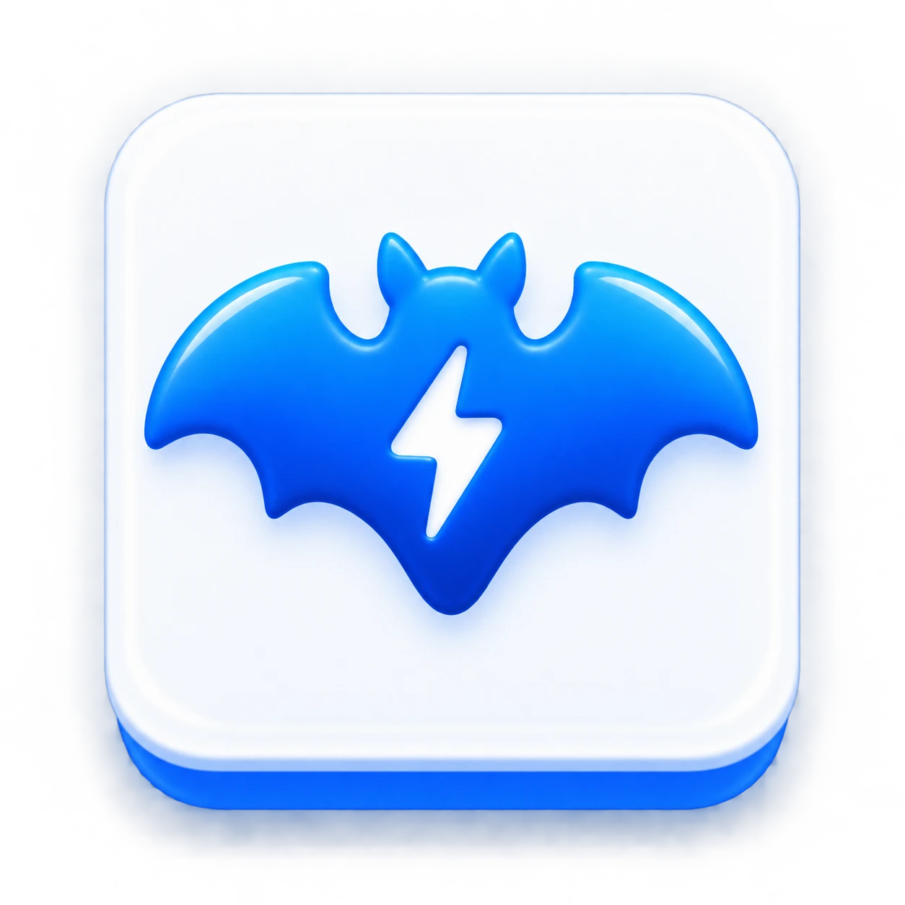
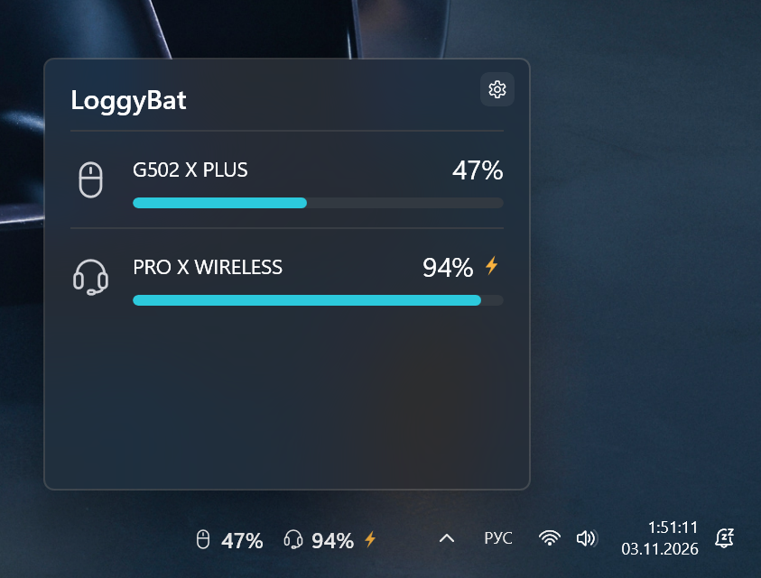

# LoggyBat

**Виджет для WidBar, показывающий заряд устройств Logitech через G HUB.**

[English version](README.md) — основная; при расхождениях действует английский текст.

LoggyBat — не отдельная панель и не замена WidBar. Это виджет: на панель задач Windows 11 его выводит
приложение [WidBar](https://apps.microsoft.com/detail/9PKLDNM83TP9), а заряд устройств он получает из
запущенного Logitech G HUB. Для работы нужны **WidBar** и **запущенный Logitech G HUB**.

## Что нужно

- Windows 11, x64
- [WidBar](https://apps.microsoft.com/detail/9PKLDNM83TP9) из Microsoft Store — **устанавливается первым**
- [Logitech G HUB](https://www.logitechg.com/software/ghub) — запущенный, видит ваши устройства

## Первая установка

1. Установите **WidBar** из Microsoft Store: https://apps.microsoft.com/detail/9PKLDNM83TP9
   (вместе с ним устанавливаются компоненты Microsoft Visual C++, нужные LoggyBat).
2. Установите **Logitech G HUB**: https://www.logitechg.com/software/ghub — и убедитесь, что он видит
   ваши устройства.
3. Скачайте **комплект первой установки** (`LoggyBat-first-install-x64-<версия>.zip`) на странице
   [Releases](https://github.com/mrmaxxxx/LoggyBat/releases) и распакуйте в отдельную папку.
   Условия использования (`TERMS.md`), лицензия (`LICENSE`) и лицензии и уведомления сторонних
   компонентов (`Notices\`) лежат в комплекте — их можно прочитать до установки.
4. Нажмите правой кнопкой на `Install-LoggyBat.ps1` → **Выполнить с помощью PowerShell**. Скрипт:
   1. показывает условия использования и просит ввести **ДА** (или **YES**). Любой другой ответ
      прекращает установку; на компьютере ничего не меняется;
   2. проверяет, что компоненты Microsoft Visual C++ (VCLibs), которые ставятся вместе с WidBar,
      установлены для вашей учётной записи в нужной версии. Если нет — останавливается: установите или
      обновите WidBar из Microsoft Store и запустите скрипт снова;
   3. запускает установочный скрипт Microsoft из комплекта (`Install.ps1`), который устанавливает
      сертификат, Windows App Runtime из комплекта и LoggyBat.
5. Добавьте виджет: **WidBar → Layout → Refresh → LoggyBat**.

> [!WARNING]
> **О сертификате.** LoggyBat подписан **самоподписанным сертификатом разработчика `CN=Max`**, а не через
> Microsoft Store. Во время установки скрипт Microsoft предложит добавить этот сертификат в доверенные
> сертификаты компьютера («Доверенные лица»); для этого нужны **права администратора**. Доверяйте
> сертификату, только если доверяете источнику, из которого скачали LoggyBat.

Первая установка этим комплектом на чистом компьютере **пока не проверена**.

## Обновление

Если LoggyBat уже установлен, используйте **комплект обновления** (`LoggyBat-update-x64-<версия>.zip`):

1. Распакуйте его в отдельную папку.
2. **Полностью закройте WidBar** (значок в трее → выход): Windows не может заменить файлы работающего виджета.
3. Нажмите правой кнопкой на `Update-LoggyBat.ps1` → **Выполнить с помощью PowerShell**. Если условия
   этой версии вы ещё не принимали, скрипт покажет их и попросит ввести **ДА** / **YES**; отказ
   прекращает обновление без изменений. Скрипт ставит новую версию поверх старой (без удаления)
   и снова запускает WidBar.

Отдельный `.msix` как самостоятельный способ установки не предлагается.

## Настройки

Откройте flyout и нажмите шестерёнку WidBar (или *Configure* в WidBar). Настройки сохраняются кнопкой
**Сохранить**; **Отмена** возвращает прежний вид.

- **Сколько устройств** показывать на панели: 1, 2 (по умолчанию) или 3.
- **Какие устройства и в каком порядке.** Ничего не отмечено (по умолчанию) — автоматически: мышь,
  гарнитура, клавиатура, микрофон, остальные. Отмеченное устройство сохраняет своё место, пока оно
  выключено: на панели `—`, другое устройство на его место не встаёт. Устройства запоминаются по модели,
  потому что G HUB не даёт постоянного номера отдельного устройства: два одинаковых устройства
  отмечаются и переставляются вместе, но показываются по отдельности, каждое со своим зарядом.
- **Диагностика** во flyout (по умолчанию выключена): время ответа G HUB и причина `—` под каждым
  устройством.
- **Обновления:** установленная версия, кнопка **Проверить сейчас** и автоматическая проверка.

## Проверка обновлений

LoggyBat может сообщить о новой версии: справа на виджете появляется красная точка, во flyout — номер
версии и ссылка на страницу релиза. **Ничего не скачивается и не устанавливается автоматически** —
комплект обновления вы ставите сами.

Для этого LoggyBat запрашивает у GitHub сведения о последнем опубликованном релизе
(`api.github.com/repos/mrmaxxxx/LoggyBat/releases/latest`). Автоматическая проверка **включена по
умолчанию**: после успешной проверки следующий запрос — не раньше чем через сутки, после ошибки
повторная попытка — не раньше чем через час. Она выключается в настройках; пока она выключена, LoggyBat
не отправляет запросов в GitHub, если вы не нажмёте **Проверить сейчас**. Кнопка **Проверить сейчас**
отправляет запрос сразу, независимо от этих интервалов. GitHub получает обычные данные
веб-запроса, в том числе ваш IP-адрес, и `LoggyBat/<версия>` в качестве User-Agent; сведения об
устройствах не передаются. Подробнее: [TERMS.md](TERMS.md), раздел 6.

## Совместимость

Проверенные устройства:

- Logitech G502 X PLUS
- Logitech PRO X WIRELESS

Поддержка других моделей не проверена и не гарантируется. Устройства, у которых G HUB не показывает
заряд, в LoggyBat не появятся.

## Ограничения

- Без запущенного G HUB вместо заряда показывается `—`, причина — во flyout.
- Сразу после запуска виджета или устройства G HUB может несколько секунд (до ~20 с) не отдавать
  заряд — в это время показывается `—`.
- На панели — до трёх устройств (задаётся в настройках); во flyout — все.
- Значок микрофона назначен типу устройства G HUB `MICROPHONE`, который на реальном устройстве ещё не
  встречался; устройства неизвестных типов получают 🔋.
- Время во flyout — момент ответа G HUB, а не момент измерения заряда.
- Процент берётся из G HUB как есть; однажды наблюдалось расхождение на 1 % с окном G HUB, причина не
  выяснена.

Пока не проверено: первая установка на чистом компьютере, восстановление после перезапуска G HUB,
после сна и после перезагрузки, три и более устройства.

## Лицензия и условия

- Собственный код LoggyBat: [лицензия MIT](LICENSE), Copyright (c) 2026 mrmaxxxx. Лицензия MIT не
  распространяется на сторонние компоненты.
- Сторонние компоненты сохраняют свои лицензии и уведомления: они в папке `Notices` пакета и комплектов;
  уведомление шаблона — в [THIRD_PARTY_NOTICES.md](THIRD_PARTY_NOTICES.md).
- Условия использования: [TERMS.md](TERMS.md) (английский — основной, русский — перевод).

## Контакт

Вопросы и сообщения о проблемах: [GitHub Issues](https://github.com/mrmaxxxx/LoggyBat/issues).

## Для разработки

Устройство проекта, сборка, подпись, история проверок и откат: [docs/HANDOFF.md](docs/HANDOFF.md).
Справка по WidBar SDK: [wiki/](wiki/Home.md). Проект создан на основе шаблона
[andelby/widbar-widget-template](https://github.com/andelby/widbar-widget-template).
